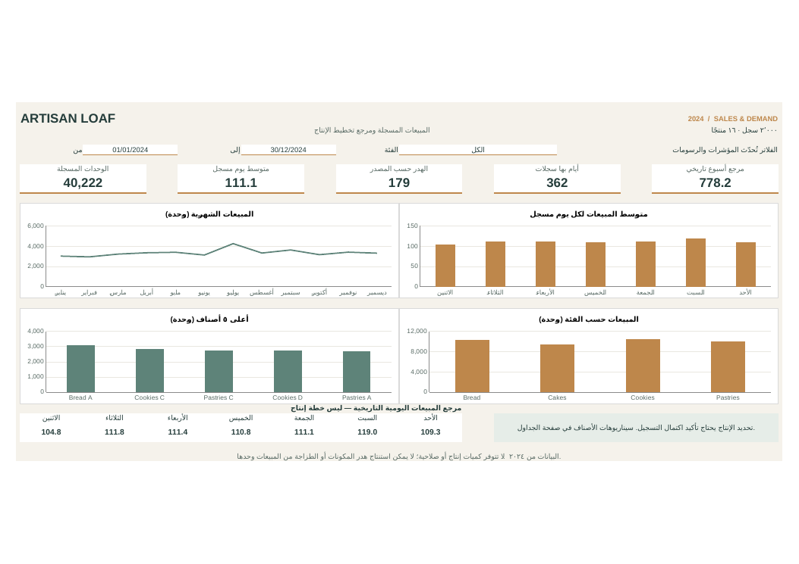

# Artisan Loaf Bakery Sales Dashboard

**Tools:** Microsoft Excel, Power BI

## Goal

Analyze 2024 bakery sales by month, weekday, product, category and channel.

## What I did

- Cleaned the 2,000 sales records: converted dates to Excel dates and sorted the rows, without changing sales or deleting rows
- Built summary tables and an Excel dashboard with date and category filters
- Built a one-page Power BI report with cards, line, pie and column charts and slicers for Category, Channel, Season and Year

## Findings (2024 data, 2,000 records)

- Total units sold: 40,222.
- Cookies were the top category (10,439 units), followed by Bread (10,260).
- Bread A was the top product (3,090 units).
- Online was the largest channel (14,177 units), then Delivery and In-Store.
- Saturday had the highest average daily sales (119.0 units).

## Note

The data records sales only. It has no production quantities or shelf life, so it cannot show ingredient waste or freshness.
