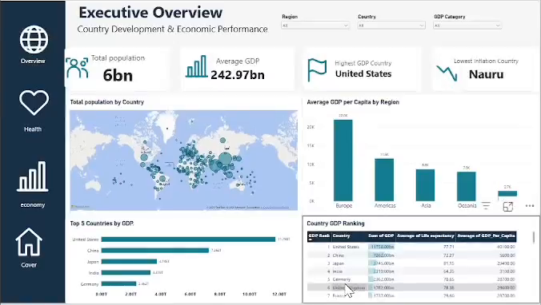

# Country Development & Economic Performance (DEPI Assignment 3)

**Tools:** Power BI, Power Query, DAX

## Goal

How do economic performance, health and population indicators connect?

## What I did

- Prepared the data with Power Query, built the data model and DAX measures
- Three interactive pages: Executive Overview (population, GDP, country rankings), Health & Population (life expectancy, birth and death rates, infant mortality, GDP vs life expectancy), Economic Performance (GDP growth, inflation, imports, exports, trade balance)
- Added interactive filters, conditional formatting and page navigation

## Biggest takeaway

- Meaningful analysis starts with getting the calculations right. Missing values are not zeros, rates should not simply be added together, and every indicator needs a clear unit.
- The report uses historical data from the source, not current country conditions.
