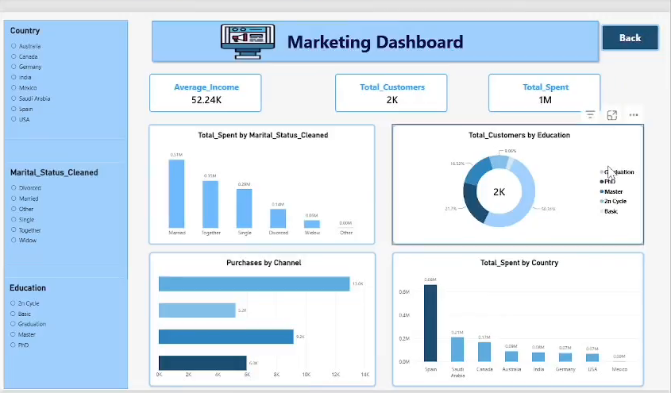

# Marketing Analytics Dashboard

**Tools:** Power BI

## Goal

Analyze customer spending and purchasing patterns.

## What I did

- Cleaned errors and missing values
- Built table relationships
- Wrote DAX measures for customer spending and purchasing patterns
- Designed an interactive dashboard of customer profiles and purchases by channel

## Findings

- Spain was the highest-spending country.
- Married customers had the largest total purchases.
