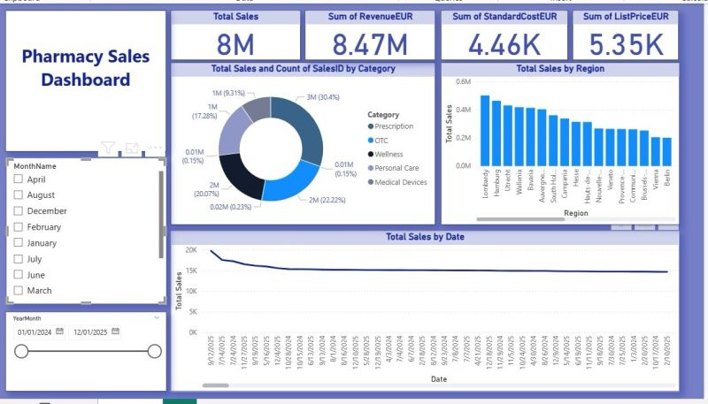

# Pharmacy Sales Dashboard

**Tools:** Power BI, Power Query, Python, SQL

## Goal

Analyze pharmacy sales data to support business decisions.

## What I did

- Transformed the sales data with Power Query
- Processed the data with Python and wrote SQL queries
- Built table relationships and an interactive Power BI dashboard of sales, revenue trends, categories and regional performance

## What I used the dashboard for

- Finding the top-selling products and the countries with the highest sales volume.
- Finding which country had the highest skincare sales and which product sold least.
