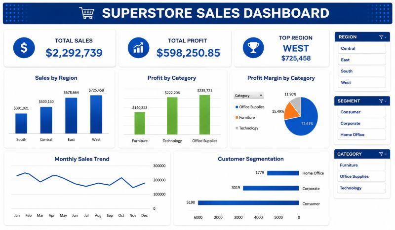

# Superstore Sales Dashboard

**Tools:** Microsoft Excel

## Goal

Prepare the Superstore sales data and show sales, profit, regions, categories and customer segments.

## What I did

- Cleaned and transformed the data with Power Query
- Analyzed sales and profitability with Pivot Tables
- Created KPI cards, charts and interactive filters for regional sales, category profitability, monthly trends and customer segments

## Findings (as shown on the dashboard)

- Total sales: $2,292,739.
- Total profit: $598,250.85.
- Top region: West ($725,458).
